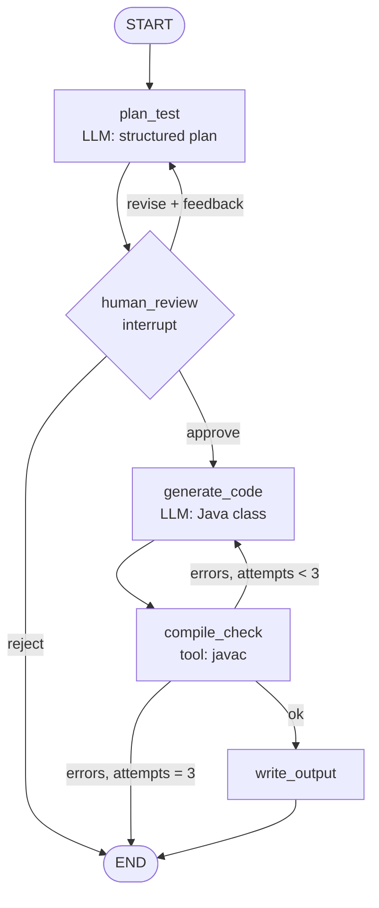

# Building AI Agents from Scratch

Sep 26, 2026 · @Govind Divekar

## TL;DR

LangGraph is the best default for building a production agent from scratch in 2026. It has the most real-world usage (roughly 34–39M monthly PyPI downloads, 1.0 GA since Oct 22, 2025) and native checkpointing, human-in-the-loop and time-travel debugging. [source](https://dev.to/jamilxt/langgraph-vs-crewai-vs-openai-agents-sdk-picking-your-agent-framework-in-2026-2heo)

- **Most used frameworks:** LangGraph, CrewAI, OpenAI Agents SDK, Microsoft Agent Framework, Google ADK, LlamaIndex Workflows, plus Claude Agent SDK, Pydantic AI and Mastra (TypeScript).
- **Pick by failure mode, not README:** LangGraph for control and durability, CrewAI for fast role-based prototypes, OpenAI Agents SDK for light handoff chains, Microsoft Agent Framework for .NET/Azure.
- **Sample agent built here:** a *Test Case → TestNG Generator* that reads a manual test case, plans a Selenium/TestNG class, pauses for human approval, generates Java code, self-checks it with `javac`, and retries on failure.
- **Stack:** Python 3.11+, `langgraph` 1.x, `langchain-openai` (routes to OpenRouter or directly to xAI's Grok — no Anthropic key needed), SQLite checkpointer, LangSmith for tracing.

## Framework landscape

Nine frameworks cover almost all agent building in 2026; LangGraph leads on production adoption and CrewAI on GitHub stars. Sorted by production usage signal.

| Framework | Adoption signal (mid-2026) | Language | Mental model | Durable state / HITL | Best fit |
| --- | --- | --- | --- | --- | --- |
| [LangGraph](https://www.langchain.com/langgraph) (LangChain) | \~34–39M PyPI downloads/month; 1.0 GA Oct 2025; used by Klarna, Replit, Uber, LinkedIn | Python, TS | Agent = state machine (graph of nodes + edges) | Native checkpointing after every node, `interrupt()` for human review, time-travel | Production agents needing control, retries, approval gates |
| [CrewAI](https://www.crewai.com) | 44–53k GitHub stars; \~5.2M downloads/month | Python | Agent system = a team with roles, goals, backstories | No built-in checkpointing; HITL via callbacks | Fast role-based multi-agent prototypes |
| [OpenAI Agents SDK](https://github.com/openai/openai-agents-python) | \~27k stars; \~10.3M downloads/month; still 0.x | Python, TS | Agent = handoff chain + guardrails | Sessions (SQLite/Redis); no crash recovery | Scoped assistants, simple delegation; provider-agnostic via LiteLLM |
| [Microsoft Agent Framework](https://github.com/microsoft/agent-framework) | 1.0 GA Apr 3, 2026; successor to AutoGen + Semantic Kernel | Python, .NET | Agents + graph workflows | Checkpointing and HITL in workflows | Azure / .NET shops |
| [Google ADK](https://github.com/google/adk-python) | \~19k stars | Python (+ Java/Go) | Opinionated agent runtime + ADK Web debug UI | Sessions + Memory Bank; configure external storage | GCP-native teams (Vertex AI, Cloud Run) |
| [LlamaIndex Workflows](https://github.com/run-llama/llama-agents) | Part of the LlamaIndex ecosystem | Python | Event-driven steps | Manual | RAG / document-heavy pipelines |
| LangChain `create_agent` | \~134k stars (LangChain overall) | Python, TS | Prebuilt tool-calling loop (runs on LangGraph) | Inherits LangGraph checkpointer | Quick single agents with any provider |
| Claude Agent SDK (Anthropic) | Powers Claude Code | Python, TS | Agent harness: file, shell, MCP tools built in | Session resume | Coding and ops agents on Claude |
| [Mastra](https://github.com/mastra-ai/mastra) | \~23k stars | TypeScript | Workflows + memory + Studio | Built-in workflows and memory | TypeScript / Next.js teams |

Sources: [dev.to comparison, Sep 2026](https://dev.to/jamilxt/langgraph-vs-crewai-vs-openai-agents-sdk-picking-your-agent-framework-in-2026-2heo) · [LangChain framework review, Jun 2026](https://www.langchain.com/resources/ai-agent-frameworks) (vendor-written; weigh accordingly) · [Intuz, Jul 2026](https://www.intuz.com/blog/top-5-ai-agent-frameworks-2025/). Claude Agent SDK row is from general knowledge, not a sourced figure.

## Why LangGraph is the pick

LangGraph wins on the four criteria that decide whether an agent survives production: explicit control, durability, human review and debuggability. Its cost is verbosity and a 1–2 week learning curve.

| Criterion | LangGraph | CrewAI | OpenAI Agents SDK | MS Agent Framework |
| --- | --- | --- | --- | --- |
| Control over each step | Full: you write every node and edge | Low: framework runs the "meeting" | Medium: handoffs | High: graph workflows |
| Crash recovery / resume | Native checkpointer | Needs external layer | Needs Temporal/DBOS | Workflow checkpoints |
| Human-in-the-loop | `interrupt()` + `Command(resume=…)` primitive | Callbacks | Manual state handling | Supported |
| Debugging | Time-travel over checkpoints + LangSmith traces | Read outputs backward | Built-in tracing | OpenTelemetry + DevUI |
| Model lock-in | None (any LangChain chat model per node) | None (LiteLLM) | Hosted tools OpenAI-only | None |
| Learning curve | 1–2 weeks | 3–5 days | 2–3 days | \~1 week |

**When not to use it:** a linear flow calling 2–3 tools needs no framework; a plain SDK loop with a `max_steps` cap is simpler. Reach for LangGraph once you need loops with conditions, approval gates, or resumable long runs.

**Runners-up to know:** CrewAI for a same-week demo; Microsoft Agent Framework if your org standardises on Azure/.NET; Claude Agent SDK when the agent mostly edits files and runs shell commands.

## Core concepts: the mental model

A LangGraph agent is a typed state object passed through a graph of Python functions; the LLM is just one kind of node. Learn these eight primitives and every agent becomes readable.

| Primitive | What it is | Import / API | Java/TestNG analogy |
| --- | --- | --- | --- |
| **State** | A `TypedDict` (or Pydantic model) holding everything the agent knows | `class State(TypedDict): ...` | A test context object shared across steps |
| **Reducer** | Rule for merging a node's update into a state key (default: overwrite) | `Annotated[list, operator.add]`, `add_messages` | Append vs. replace on a list field |
| **Node** | A function `state -> partial state update` | `builder.add_node("plan", plan_node)` | A `@Test` step method |
| **Edge** | Fixed transition between nodes | `builder.add_edge("a", "b")`, `START`, `END` | `dependsOnMethods` |
| **Conditional edge** | A router function that picks the next node from state | `builder.add_conditional_edges("check", route)` | An `if` in a test flow / retry analyzer |
| **Tool** | A typed function the LLM may call | `@tool` + `model.bind_tools([...])` | A page-object method the agent can invoke |
| **Checkpointer** | Saves state after every node, keyed by `thread_id` | `InMemorySaver`, `SqliteSaver`, `PostgresSaver` | Persisting a test run so it can resume |
| **Interrupt** | Pauses inside a node for human input; resume with `Command(resume=value)` | `from langgraph.types import interrupt, Command` | A manual verification gate |

**The agent loop in one sentence:** `START → node → (router decides) → node … → END`, with a checkpoint written after every step, so any run can be paused, inspected, resumed or replayed.

**Note on HITL:** use the dynamic `interrupt()` function, not compile-time `interrupt_before`. The official docs now reserve `interrupt_before`/`interrupt_after` for debugging breakpoints. [source](https://docs.langchain.com/oss/python/langgraph/interrupts)

**Three rules of interrupts** (from the same docs): the node re-runs from its top on resume, so side effects before `interrupt()` must be idempotent; never wrap `interrupt()` in a bare `try/except`; keep interrupt calls in a fixed order inside a node.

## Sample agent: Test Case → TestNG Generator

The example agent turns one manual test case into a compiling Selenium + TestNG class, with a human approving the plan before any code is written. It exercises every primitive above: typed state, LLM nodes, a tool, a router, a retry loop, a checkpointer and an interrupt.

**Input** - a Zephyr-style test case as JSON. This is the content you save as `testcases/IR-T101.json` in Step 0, and the only thing you edit per test case:

```json
{
  "key": "IR-T101",
  "title": "Login with valid credentials",
  "precondition": "User 'qa_user' exists and is active",
  "steps": [
    {"action": "Open https://example.com/login", "expected": "Login page is shown"},
    {"action": "Enter username qa_user and password Secret@123", "expected": "Fields accept input"},
    {"action": "Click Sign in", "expected": "Dashboard is shown with welcome banner"}
  ]
}
```

**Output:** `generated/LoginWithValidCredentialsTest.java` that compiles against Selenium 4 + TestNG, plus a run summary.

**Graph:**



| Node | Type | Reads from state | Writes to state |
| --- | --- | --- | --- |
| `plan_test` | LLM (structured output) | `test_case`, `review_feedback` | `plan` (class name, locators, steps, assertions) |
| `human_review` | Interrupt | `plan` | `review_decision`, `review_feedback` |
| `generate_code` | LLM | `plan`, `compile_errors` | `java_code`, `attempts` |
| `compile_check` | Tool (`javac` via subprocess) | `java_code` | `compile_errors` |
| `write_output` | Plain Python | `java_code`, `plan` | `output_path` |

**Why this shape:** the expensive, error-prone step (code generation) sits behind a cheap human gate, and a deterministic check (`javac`) — not the LLM — decides whether the output is acceptable.

## Step-by-step build

**How to read these steps.** Every code block below is labelled either **RUN** (type it in a terminal) or **FILE** (create the file, or add to it, in your editor). Steps 1 to 7 all build up one file, `agent.py`, in order: paste each block at the end of that file as you go, so the finished file reads top to bottom exactly as the steps are numbered. Step 8 is a second file. No code is written twice.

When you are done you will have these files and folders:

| Path | Kind | Created in | Purpose |
| --- | --- | --- | --- |
| `agent.py` | File you write | Steps 1-7 | State, tools, nodes, router, graph |
| `run.py` | File you write | Step 8 | Command-line runner: start, pause, resume |
| `test_agent.py` | File you write | Testing section | Tests with a fake model; no API key needed |
| `testcases/IR-T101.json` | File you write | Step 0 | The manual test case you feed in |
| `pom.xml` | File you write (optional) | Step 0 | Only to download the Selenium + TestNG jars |
| `lib/` | Folder Maven fills | Step 0 | The jars `javac` compiles against |
| `generated/` | Folder the agent creates | At runtime | Where the finished Java test lands |

The whole agent is about 220 lines of Python. The Python below passed its test suite (scripted model, real `javac`, SQLite crash-resume) on langgraph 1.2.12, langchain-core 1.6.5 and langchain-openai; the live model calls and the Maven step were not run here.

### Step 0 — Set up the project

**RUN** - paste these lines into a terminal, one block, top to bottom. They make the project folder and install the Python packages; no files to write yet. On the two `export` lines, put your own key and model in place of the placeholders. Those two lines last only as long as that terminal window, so run them again in every new terminal.

```bash
mkdir tc-agent && cd tc-agent
mkdir testcases
python -m venv .venv && source .venv/bin/activate      # Windows: .venv\Scripts\activate
pip install "langgraph>=1.2" langgraph-checkpoint-sqlite langchain-openai pytest

# Paste your own values on these lines (Windows: use set instead of export)
export OPENROUTER_API_KEY=sk-or-your-key-here
export AGENT_MODEL=vendor/model-name                   # a real slug from openrouter.ai/models

# Only if you'd rather call Grok directly instead of through OpenRouter:
# export LLM_PROVIDER=xai
# export XAI_API_KEY=xai-your-key-here
# export AGENT_MODEL=grok-4                             # a real slug from docs.x.ai/docs/models
```

OpenRouter is the default model provider: one key reaches models from many vendors, billed per token, with some `:free` models — Grok's models are available there too. Create the key at [openrouter.ai/keys](https://openrouter.ai/keys). If you'd rather use your own xAI key directly, set `LLM_PROVIDER=xai` plus `XAI_API_KEY` — see [Using xAI (Grok) directly](#using-xai-grok-directly) below. This guide needs no Anthropic key at all; the Anthropic branch in Step 3 is left in only as a reference for readers who have one. You need no key at all to run the `pytest` suite.

Next, two files to create by hand.

**FILE** - `testcases/IR-T101.json`. Create the `testcases` folder, and in it a file named `IR-T101.json` holding the test-case JSON from the Sample agent section above. This is the agent's input; one file per test case, named however you like.

**FILE** - `pom.xml`, in the project root. This is not a Java project you will build; the file exists only so Maven can download the Selenium and TestNG jars that `javac` needs to check the generated code. Paste exactly this:

```xml
<project xmlns="http://maven.apache.org/POM/4.0.0">
  <modelVersion>4.0.0</modelVersion>
  <groupId>com.example</groupId><artifactId>tc-agent-libs</artifactId><version>1.0</version>
  <dependencies>
    <dependency><groupId>org.seleniumhq.selenium</groupId><artifactId>selenium-java</artifactId><version>4.25.0</version></dependency>
    <dependency><groupId>org.testng</groupId><artifactId>testng</artifactId><version>7.10.2</version></dependency>
  </dependencies>
</project>
```

**RUN** - then download the jars into `lib/`, which is where `CLASSPATH` points:

```bash
mvn dependency:copy-dependencies -DoutputDirectory=lib
```

Bump the two jar versions to whatever your own test project uses. If you have no Maven installed, you can skip both of these: the agent still plans and generates Java, but `compile_check` will report errors it cannot resolve, so the fix loop will spin to `MAX_ATTEMPTS` and stop. Everything else in the guide works without them.

### Step 1 — Imports and config: start agent.py

**FILE** - create `agent.py` in the project root, and make this its first lines.

```python
"""Test Case -> TestNG Generator: a LangGraph agent built from scratch.

Flow: plan_test -> human_review (interrupt) -> generate_code -> compile_check -> write_output
      with a revise loop (review -> plan) and a fix loop (compile errors -> generate).
"""
from __future__ import annotations

import json
import os
import re
import subprocess
import tempfile
from pathlib import Path
from typing import Literal, TypedDict

from pydantic import BaseModel, Field
from langchain_core.messages import HumanMessage, SystemMessage
from langchain_core.tools import tool
from langgraph.graph import END, START, StateGraph
from langgraph.types import Command, interrupt

MAX_ATTEMPTS = 3
PROVIDER = os.getenv("LLM_PROVIDER", "openrouter")   # "openrouter", "xai", or "anthropic"
MODEL = os.getenv("AGENT_MODEL", "")                # e.g. a slug copied from openrouter.ai/models
# Selenium + TestNG jars; e.g. copy them into ./lib with `mvn dependency:copy-dependencies`
CLASSPATH = os.getenv("TEST_CLASSPATH", "lib/*")
OUTPUT_DIR = Path(os.getenv("OUTPUT_DIR", "generated"))
```

### Step 2 — Define the state: agent.py

**FILE** - add to the end of `agent.py`, below the imports.

State is the agent's only memory. Keep every value JSON-serialisable (store the Pydantic plan as a dict) so any checkpointer can save it. The Pydantic models double as the LLM's output schema in Step 5.

```python
class PlanStep(BaseModel):
    action: str = Field(description="What the test does in this step")
    locator: str = Field(description="Selenium locator, e.g. By.id(\"username\")")
    expected: str = Field(description="Expected result from the test case")
    assertion: str = Field(description="TestNG assertion that verifies the expected result")


class TestPlan(BaseModel):
    class_name: str = Field(description="PascalCase Java class name ending in 'Test'")
    package: str = Field(default="com.example.tests")
    base_url: str
    steps: list[PlanStep]


class AgentState(TypedDict, total=False):
    test_case: dict            # input: the manual test case
    plan: dict                 # TestPlan as a dict (JSON-serialisable for the checkpointer)
    review_feedback: str       # reviewer notes when they ask for a revision
    java_code: str             # latest generated source
    compile_errors: str        # "" when the last compile passed
    attempts: int              # code-generation attempts so far
    output_path: str
    status: str                # generated | rejected | failed_compilation
```

### Step 3 — Choose the model in one place: agent.py

**FILE** - add to the end of `agent.py`.

One factory function makes the provider swappable (OpenRouter by default, Anthropic directly, or a local model later) and lets tests replace it with a fake. OpenRouter speaks the OpenAI API, so the standard `ChatOpenAI` class works once you change its `base_url` and key.

```python
def get_llm():
    """Single place to choose the model; tests monkeypatch this."""
    if PROVIDER == "openrouter":
        from langchain_openai import ChatOpenAI
        return ChatOpenAI(
            model=MODEL,                                   # OpenRouter slug, e.g. "vendor/model-name"
            base_url="https://openrouter.ai/api/v1",
            api_key=os.environ["OPENROUTER_API_KEY"],
            temperature=0,
            max_tokens=4096,
            default_headers={"X-OpenRouter-Title": "tc-agent"},   # optional app attribution
        )
    if PROVIDER == "xai":
        from langchain_openai import ChatOpenAI             # xAI's API is OpenAI-compatible
        return ChatOpenAI(
            model=MODEL or "grok-4",                         # a slug from docs.x.ai/docs/models
            base_url="https://api.x.ai/v1",
            api_key=os.environ.get("XAI_API_KEY") or os.environ["GROK_API_KEY"],
            temperature=0,
            max_tokens=4096,
        )
    from langchain_anthropic import ChatAnthropic          # direct Anthropic key (not needed for OpenRouter/xAI)
    return ChatAnthropic(model=MODEL or "claude-sonnet-5", temperature=0, max_tokens=4096)
```

#### Using OpenRouter

| Setting | Value |
| --- | --- |
| Base URL | `https://openrouter.ai/api/v1` |
| API key | `OPENROUTER_API_KEY`, created at openrouter.ai/keys |
| Model ID | A `vendor/model-name` slug copied from [openrouter.ai/models](https://openrouter.ai/models); a `:free` suffix marks the free variant |
| Optional headers | `HTTP-Referer` and `X-OpenRouter-Title` only label your app on OpenRouter's leaderboards |

**Free-model limits** (IDs ending in `:free`):

| Credits purchased, all time | Requests per minute | Requests per day |
| --- | --- | --- |
| Under $10 | 20 | 50 |
| $10 or more | 20 | 1,000 |

This agent makes about 2–5 model calls per test case (plan, code, plus any revise or compile-fix loops), so the 50-a-day free tier covers roughly 10–25 test cases. `MAX_ATTEMPTS` caps the calls per run.

**Check your usage** at any time; the response includes credits used, any per-key limit remaining, and free-model requests used today (UTC day):

```bash
curl -s https://openrouter.ai/api/v1/key -H "Authorization: Bearer $OPENROUTER_API_KEY"
```

**Pick a model that supports structured output.** The planner uses `with_structured_output(TestPlan)`. Not every model, and few free ones, reliably support tool calling or JSON schemas. Check the supported parameters on the model's OpenRouter page. If `plan_test` raises a parsing error, the model is the usual cause.

| Error | Likely cause |
| --- | --- |
| 401 | Missing or wrong `OPENROUTER_API_KEY` in this shell |
| 404 / model not found | Slug misspelled; copy it from the models page |
| 429 | Free-model per-minute or daily limit; wait, or add credits |

Verification: the OpenRouter wiring builds and all six tests pass, but I made no live OpenRouter call because no key was available here. Run one real test case and confirm before relying on it. Settings above come from OpenRouter's [quickstart](https://openrouter.ai/docs/quickstart) and [limits](https://openrouter.ai/docs/api-reference/limits) pages; the error table is general experience, not from those pages.

#### Using xAI (Grok) directly

| Setting | Value |
| --- | --- |
| Base URL | `https://api.x.ai/v1` |
| API key | `XAI_API_KEY` (the code also accepts `GROK_API_KEY`), created at [console.x.ai](https://console.x.ai) |
| Model ID | A slug such as `grok-4` or `grok-4-fast`, listed at [docs.x.ai/docs/models](https://docs.x.ai/docs/models) |
| Enable it | `export LLM_PROVIDER=xai` plus the key above, in place of the OpenRouter export lines in Step 0 |

xAI's API is OpenAI-compatible, so `get_llm()` reuses `ChatOpenAI` with a different `base_url` — no extra package beyond `langchain-openai`, which Step 0 already installs. Check the model's tool-calling/structured-output support in xAI's docs before relying on `plan_test`'s `with_structured_output(TestPlan)` call, the same caveat as for OpenRouter models above.

Grok's models are also reachable through OpenRouter (e.g. slug `x-ai/grok-4`), so you can skip a separate xAI key entirely and just point `AGENT_MODEL` at a Grok slug while staying on `LLM_PROVIDER=openrouter` — useful if you want one key and one bill for everything.

Verification: this wiring was written from xAI's published OpenAI-compatible API reference; no live call was made here because no key was available. Confirm with one real test case before relying on it.

#### Why you can't just "log in" like Hermes does

[Nous Research's Hermes Agent](https://hermes-agent.nousresearch.com/) (CLI and desktop app) can connect to Grok and Claude by logging in, with no API key pasted. It is possible because Hermes implements each provider's login flow itself. Hermes has three separate paths, and only the first two are logins:

| Provider | How Hermes connects | Where the credential lives | What it bills |
| --- | --- | --- | --- |
| xAI Grok | `hermes auth add xai-oauth`: browser OAuth device-code login against `accounts.x.ai`; needs a SuperGrok or X Premium+ subscription | Tokens in `~/.hermes/auth.json` on your machine, refreshed automatically | Your subscription, not API spend |
| Anthropic Claude | `hermes auth add anthropic --type oauth`: "Claude Code OAuth"; Hermes routes requests as Claude Code against your Anthropic account | Claude Code's own credential store, not copied into Hermes's files | Max plan with purchased extra credits only; Pro plans cannot use it |
| Nous Portal | One Nous sign-in reaches 200+ models | Refresh token in `~/.hermes/auth.json` | Nous credits |

Hermes also accepts a plain API key for each provider (`XAI_API_KEY`, `ANTHROPIC_API_KEY`), and the docs list that as the fallback when a login is refused.

**Can this agent do the same?** Not out of the box, for three reasons:

1. **The login lives in Hermes, not in the provider SDK.** `ChatOpenAI` and `ChatAnthropic` in `get_llm()` just take an `api_key`. LangChain has no "sign in with Grok" or "sign in with Claude" step, so you would have to write and maintain the OAuth device-code flow, token storage and refresh yourself.
2. **The providers gate the login path.** Hermes's own docs say xAI "enforces its own allowlist on the OAuth API surface" and that some SuperGrok subscribers get HTTP 403 even after a successful login, with an API key as the workaround. The Anthropic path works by presenting the request as Claude Code, and the docs warn that rotating a borrowed Claude Code login can invalidate its owner's refresh token.
3. **Subscription terms.** The xAI and Anthropic pages Hermes cites cover Hermes and Claude Code's own use. I found nothing confirming that a subscription token may be used from your own LangGraph code, so check each provider's current terms before trying it. This guide does not rely on it.

**What to do instead:** keep an API key. Your OpenRouter key already gives one-key access to many vendors, and a direct `XAI_API_KEY` works through the `xai` branch above. Both are billed per token, separately from any SuperGrok or Claude subscription. If you only want to use your subscriptions interactively, run Hermes itself; if you want the LangGraph agent to run unattended, use API keys. If your own users should "just log in" to your agent, build the broker layer yourself: users sign into your app, and your backend holds the keys.

*Verification: this section is based on Hermes's public docs (linked in Sources) and was not tested against a live Hermes install or a live login. The Hermes desktop app's exact storage location was not confirmed from the docs; the paths above are the CLI's.*

### Step 4 — Write the tools: agent.py

**FILE** - add to the end of `agent.py`.

`@tool` turns a typed, documented function into something an LLM can call via `llm.bind_tools([...])`. Here a node calls it directly instead, because the compile check must run every time, not when the model feels like it. Rule of thumb: let the LLM choose tools when the choice is the judgement; call them yourself when the step is mandatory.

````python
@tool
def compile_java(java_code: str) -> str:
    """Compile one Java source file with javac. Returns 'OK' or the compiler errors."""
    match = re.search(r"public\s+class\s+(\w+)", java_code)
    if not match:
        return "error: no 'public class' declaration found"
    with tempfile.TemporaryDirectory() as tmp:
        src = Path(tmp) / f"{match.group(1)}.java"
        src.write_text(java_code)
        proc = subprocess.run(
            ["javac", "-cp", CLASSPATH, "-d", tmp, str(src)],
            capture_output=True, text=True, timeout=120,
        )
        return "OK" if proc.returncode == 0 else proc.stderr[-4000:]


def strip_fences(text: str) -> str:
    """Remove markdown code fences if the model added them anyway."""
    text = text.strip()
    text = re.sub(r"^```[a-zA-Z]*\s*\n", "", text)
    return re.sub(r"\n```\s*$", "", text).strip()
````

### Step 5 — Write the nodes: agent.py

**FILE** - add to the end of `agent.py`. This is the longest block; the two prompt strings go in the file too.

Each node takes the full state and returns only the keys it changes. `with_structured_output(TestPlan)` forces the planner to return a validated object instead of free text. `human_review` returns a `Command`, which updates state and picks the next node in one step.

```python
PLAN_PROMPT = """You are a senior QA automation engineer.
Convert the manual test case into a Selenium 4 + TestNG test plan.
Prefer By.id, then By.cssSelector; use By.xpath only as a last resort.
Write one assertion per expected result."""

CODE_PROMPT = """Write ONE complete Java 17 class that implements the plan with Selenium 4 and TestNG 7.
Rules:
- Use the package and class name from the plan.
- Create ChromeDriver in @BeforeMethod and quit it in @AfterMethod.
- Use WebDriverWait with Duration.ofSeconds(10); never Thread.sleep.
- Use org.testng.Assert for every assertion in the plan.
Return only Java source, no markdown fences, no explanation."""


def plan_test(state: AgentState) -> dict:
    llm = get_llm().with_structured_output(TestPlan)
    messages = [SystemMessage(PLAN_PROMPT),
                HumanMessage(json.dumps(state["test_case"], indent=2))]
    if state.get("review_feedback"):
        messages.append(HumanMessage(
            "Revise your previous plan using this reviewer feedback:\n"
            f"{state['review_feedback']}\n\nPrevious plan:\n{json.dumps(state['plan'], indent=2)}"))
    plan: TestPlan = llm.invoke(messages)
    return {"plan": plan.model_dump(), "review_feedback": ""}


def human_review(state: AgentState) -> Command[Literal["generate_code", "plan_test", "__end__"]]:
    # Everything before interrupt() re-runs on resume, so keep this node side-effect free.
    decision = interrupt({
        "question": "Approve this test plan? (approve / revise / reject)",
        "plan": state["plan"],
    })
    action = decision.get("action", "reject")
    if action == "approve":
        return Command(goto="generate_code")
    if action == "revise":
        return Command(update={"review_feedback": decision.get("feedback", "")}, goto="plan_test")
    return Command(update={"status": "rejected"}, goto=END)


def generate_code(state: AgentState) -> dict:
    messages = [SystemMessage(CODE_PROMPT),
                HumanMessage("Plan:\n" + json.dumps(state["plan"], indent=2))]
    if state.get("compile_errors"):
        messages.append(HumanMessage(
            f"Your previous code failed to compile:\n{state['compile_errors']}\n\n"
            f"Previous code:\n{state['java_code']}\n\nReturn the full corrected class."))
    response = get_llm().invoke(messages)
    return {"java_code": strip_fences(response.text),
            "attempts": state.get("attempts", 0) + 1}


def compile_check(state: AgentState) -> dict:
    result = compile_java.invoke({"java_code": state["java_code"]})
    errors = "" if result == "OK" else result
    update: dict = {"compile_errors": errors}
    if errors and state["attempts"] >= MAX_ATTEMPTS:
        update["status"] = "failed_compilation"
    return update


def write_output(state: AgentState) -> dict:
    name = re.search(r"public\s+class\s+(\w+)", state["java_code"]).group(1)
    OUTPUT_DIR.mkdir(parents=True, exist_ok=True)
    path = OUTPUT_DIR / f"{name}.java"
    path.write_text(state["java_code"])
    return {"output_path": str(path), "status": "generated"}
```

### Step 6 — Add the router: agent.py

**FILE** - add to the end of `agent.py`.

A router reads state and returns the next node's name. This is where loop limits live; an agent without a cap can burn tokens forever.

```python
def route_after_compile(state: AgentState) -> str:
    if not state["compile_errors"]:
        return "write_output"
    if state["attempts"] < MAX_ATTEMPTS:
        return "generate_code"      # fix loop
    return END                      # give up after MAX_ATTEMPTS
```

### Step 7 — Wire and compile the graph: agent.py is now complete

**FILE** - add to the end of `agent.py`. Once this block is in, the file is finished; nothing else gets added to it.

`destinations=` only helps diagrams render the `Command` jumps; routing still comes from the node's return value. Compiling with a checkpointer is what enables pause, resume and history.

```python
def build_graph(checkpointer):
    builder = StateGraph(AgentState)
    builder.add_node("plan_test", plan_test)
    builder.add_node("human_review", human_review,
                     destinations=("generate_code", "plan_test", END))
    builder.add_node("generate_code", generate_code)
    builder.add_node("compile_check", compile_check)
    builder.add_node("write_output", write_output)

    builder.add_edge(START, "plan_test")
    builder.add_edge("plan_test", "human_review")
    builder.add_edge("generate_code", "compile_check")
    builder.add_conditional_edges("compile_check", route_after_compile,
                                  ["write_output", "generate_code", END])
    builder.add_edge("write_output", END)
    return builder.compile(checkpointer=checkpointer)
```

### Step 8 — Drive it: the second file, run.py

**FILE** - create a second file, `run.py`, beside `agent.py`, holding all of this. It imports `build_graph` from the file you just finished.

`thread_id` is the run's identity. The same id after a crash or restart resumes from the last checkpoint instead of starting over.

```python
"""CLI runner: start a run, answer the review interrupt, resume after a crash."""
import json
import sys

from langgraph.checkpoint.sqlite import SqliteSaver
from langgraph.types import Command

from agent import build_graph


def ask_reviewer(request: dict) -> dict:
    print("\n=== PLAN FOR REVIEW ===")
    print(json.dumps(request["plan"], indent=2))
    action = input(f"\n{request['question']} > ").strip().lower()
    feedback = input("Feedback for the planner > ") if action == "revise" else ""
    return {"action": action, "feedback": feedback}


def main(test_case_file: str, thread_id: str) -> None:
    config = {"configurable": {"thread_id": thread_id}}
    with SqliteSaver.from_conn_string("checkpoints.db") as checkpointer:
        graph = build_graph(checkpointer)

        snapshot = graph.get_state(config)
        if snapshot.interrupts:                 # paused earlier: resume, don't restart
            decision = ask_reviewer(snapshot.interrupts[0].value)
            result = graph.invoke(Command(resume=decision), config)
        else:
            with open(test_case_file) as f:
                result = graph.invoke({"test_case": json.load(f), "attempts": 0}, config)

        while "__interrupt__" in result:        # every pause surfaces here
            decision = ask_reviewer(result["__interrupt__"][0].value)
            result = graph.invoke(Command(resume=decision), config)

    print(f"\nstatus={result.get('status')} attempts={result.get('attempts')} "
          f"output={result.get('output_path')}")
    if result.get("compile_errors"):
        print("Last compiler errors:\n" + result["compile_errors"])


if __name__ == "__main__":
    # usage: python run.py testcases/IR-T101.json IR-T101
    main(sys.argv[1], sys.argv[2])
```

### Step 9 — Run it

**RUN** - in the terminal, from the project folder, with the virtual environment active.

```bash
python run.py testcases/IR-T101.json IR-T101
```

What happens: the planner returns a JSON plan and the run pauses; you type `approve`, `revise` (plus feedback, which loops back to the planner) or `reject`. On approve, the generator writes Java, `javac` checks it, and up to 3 attempts fix compiler errors. Success prints `status=generated output=generated/LoginWithValidCredentialsTest.java`.

Kill the process at the review prompt and rerun the same command: `get_state()` finds the pending interrupt in `checkpoints.db` and asks again, without re-running the planner (and without paying for its tokens again).

## Testing, observability and deployment

Treat the agent like any system under test: fake the LLM for deterministic graph tests, trace real runs, and swap in a durable checkpointer before production. These six tests pass in 3.4 s with no API key.

### Unit-test the graph with a scripted model

**FILE** - create `test_agent.py` beside `agent.py` and `run.py`. Then **RUN** `pytest -q` in the project folder. This needs no API key, so it is the quickest way to confirm the graph works before you spend a single token.

The LLM is the only non-deterministic part, so replace `get_llm()` with a fake. The graph, routing, interrupts, `javac` and checkpointer all run for real.

```python
"""Deterministic tests: fake LLM, real graph, real javac, in-memory checkpointer."""
import pytest
from langchain_core.messages import AIMessage
from langgraph.checkpoint.memory import InMemorySaver
from langgraph.types import Command

import agent

PLAN = agent.TestPlan(
    class_name="LoginTest", base_url="https://example.com/login",
    steps=[agent.PlanStep(action="Click Sign in", locator='By.id("signin")',
                          expected="Dashboard shown", assertion="assertTrue(banner.isDisplayed())")],
)
BROKEN = "public class LoginTest { void t() { int x = } }"
FIXED = "public class LoginTest { void t() { int x = 1; } }"


class FakeLLM:
    """Stands in for ChatAnthropic: returns scripted plans and code."""
    def __init__(self, code_replies):
        self.code_replies = list(code_replies)

    def with_structured_output(self, schema):
        return self

    def invoke(self, messages):
        if "test plan" in messages[0].content:        # the planner prompt
            return PLAN
        return AIMessage(content=self.code_replies.pop(0))


@pytest.fixture
def graph(tmp_path, monkeypatch):
    monkeypatch.setattr(agent, "OUTPUT_DIR", tmp_path)
    return agent.build_graph(InMemorySaver())


CFG = {"configurable": {"thread_id": "t1"}}
START = {"test_case": {"key": "IR-T101", "steps": []}, "attempts": 0}


def test_pauses_for_review_before_any_code(graph, monkeypatch):
    monkeypatch.setattr(agent, "get_llm", lambda: FakeLLM([FIXED]))
    result = graph.invoke(START, CFG)
    assert result["__interrupt__"][0].value["plan"]["class_name"] == "LoginTest"
    assert "java_code" not in result


def test_approve_then_fix_loop_recovers(graph, monkeypatch):
    fake = FakeLLM([BROKEN, FIXED])
    monkeypatch.setattr(agent, "get_llm", lambda: fake)
    graph.invoke(START, CFG)
    result = graph.invoke(Command(resume={"action": "approve"}), CFG)
    assert result["status"] == "generated"
    assert result["attempts"] == 2                    # one failed compile, one fix
    assert result["output_path"].endswith("LoginTest.java")


def test_gives_up_after_max_attempts(graph, monkeypatch):
    fake = FakeLLM([BROKEN] * agent.MAX_ATTEMPTS)
    monkeypatch.setattr(agent, "get_llm", lambda: fake)
    graph.invoke(START, CFG)
    result = graph.invoke(Command(resume={"action": "approve"}), CFG)
    assert result["status"] == "failed_compilation"
    assert result["attempts"] == agent.MAX_ATTEMPTS


def test_revise_loops_back_to_planner(graph, monkeypatch):
    monkeypatch.setattr(agent, "get_llm", lambda: FakeLLM([FIXED]))
    graph.invoke(START, CFG)
    result = graph.invoke(Command(resume={"action": "revise", "feedback": "use CSS"}), CFG)
    assert "__interrupt__" in result                  # planner ran again, paused again
    assert result["review_feedback"] == ""            # feedback consumed by the planner


def test_reject_ends_run(graph, monkeypatch):
    monkeypatch.setattr(agent, "get_llm", lambda: FakeLLM([]))
    graph.invoke(START, CFG)
    result = graph.invoke(Command(resume={"action": "reject"}), CFG)
    assert result["status"] == "rejected"


def test_state_history_supports_time_travel(graph, monkeypatch):
    fake = FakeLLM([BROKEN, FIXED])
    monkeypatch.setattr(agent, "get_llm", lambda: fake)
    graph.invoke(START, CFG)
    graph.invoke(Command(resume={"action": "approve"}), CFG)
    history = list(graph.get_state_history(CFG))
    nodes_run = [h.next for h in history]
    assert ("compile_check",) in nodes_run            # every step was checkpointed
```

Run with `pytest -q`. Beyond this, keep a small golden set of real test cases and score live outputs (compiles? uses explicit waits? one assertion per expected result?) whenever you change a prompt or model.

### Observe real runs

| Need | How |
| --- | --- |
| Trace every LLM call, token count and latency | `export LANGSMITH_TRACING=true LANGSMITH_API_KEY=... LANGSMITH_PROJECT=tc-agent`; no code change |
| See what the agent knew at any step | `graph.get_state_history(config)` lists every checkpoint, newest first |
| Replay or branch from a past step | `graph.invoke(None, checkpoint.config)` re-runs from that checkpoint; `graph.update_state(...)` edits state before resuming |
| Visual step-through | `pip install "langgraph-cli[inmem]"`, add `langgraph.json`, run `langgraph dev` to open LangGraph Studio |
| Print the graph | `print(graph.get_graph().draw_mermaid())` |

### Move toward production

| Concern | Local (this guide) | Production |
| --- | --- | --- |
| Checkpointer | `SqliteSaver` file | `PostgresSaver` from `langgraph-checkpoint-postgres` |
| Review UI | `input()` in a terminal | Web form, Slack or Jira comment that calls `Command(resume=...)` for the thread |
| Hosting | Python script | FastAPI service, LangSmith Deployment, or a CI job (e.g. GitHub Actions per Jira story) |
| Model | OpenRouter or xAI (Grok) via API | Same factory; swap to a local model via `langchain-ollama` when hardware allows |
| Inputs | JSON file | JIRA / Zephyr via MCP servers loaded with `langchain-mcp-adapters` |

When deploying on LangGraph Server or LangSmith Deployment, compile the graph without your own checkpointer; the platform supplies persistence.

## Pitfalls and next steps

Most agent failures come from unbounded loops, non-serialisable state and letting the LLM judge its own output. Check these before scaling up.

| Pitfall | Symptom | Fix |
| --- | --- | --- |
| No loop cap | Runaway token bill | Counter in state + router limit (`MAX_ATTEMPTS`) |
| LLM grades its own work | "Looks good" on broken code | Deterministic checks: `javac`, `mvn test`, linters |
| Side effects before `interrupt()` | Duplicate Jira comments or PRs on resume | Put side effects after the interrupt or in their own node |
| Objects in state (drivers, clients) | Checkpointer serialisation errors | Keep state to JSON; create clients inside nodes |
| Free-text plans | Parsing failures downstream | `with_structured_output(PydanticModel)` |
| One giant prompt node | Hard to debug and test | One responsibility per node; test each via the graph |
| Random `thread_id` per run | Resume never works | Use a stable business key, e.g. the Zephyr test key |

**Next steps, in order:**

1. Replace the JSON file input with the Zephyr Scale API (or your planned custom Zephyr MCP server) and Jira via its MCP server.
2. Add a `run_tests` node that runs `mvn test -Dtest=<Class>` and loops back on test failures, not just compile errors.
3. Add a `open_pr` node after `write_output` that commits to a branch and opens a GitHub PR, guarded by a second `interrupt()`.
4. Parallelise: fan out one subgraph per test case in a Jira story with LangGraph's `Send` API.
5. Move checkpoints to Postgres and turn on LangSmith tracing before sharing with the team.

## Sources

- [LangGraph vs CrewAI vs OpenAI Agents SDK, DEV Community (Sep 2026)](https://dev.to/jamilxt/langgraph-vs-crewai-vs-openai-agents-sdk-picking-your-agent-framework-in-2026-2heo)
- [The best AI agent frameworks in 2026, LangChain (Jun 2026)](https://www.langchain.com/resources/ai-agent-frameworks)
- [Best AI Agent Frameworks, Intuz (Jul 2026)](https://www.intuz.com/blog/top-5-ai-agent-frameworks-2025/)
- [AI agent frameworks comparison, Cordum (Aug 2026)](https://cordum.io/blog/ai-agent-frameworks-comparison)
- [LangGraph docs: Interrupts](https://docs.langchain.com/oss/python/langgraph/interrupts)
- [LangGraph docs home](https://docs.langchain.com/oss/python/langgraph/overview)
- [OpenRouter quickstart](https://openrouter.ai/docs/quickstart)
- [OpenRouter rate limits](https://openrouter.ai/docs/api-reference/limits)
- [xAI API reference](https://docs.x.ai/docs/api-reference)
- [xAI models](https://docs.x.ai/docs/models)
- [Hermes Agent, Nous Research](https://hermes-agent.nousresearch.com/)
- [Nous Portal](https://portal.nousresearch.com/)
- [Hermes docs: providers (Anthropic, xAI OAuth)](https://hermes-agent.nousresearch.com/docs/integrations/providers)
- [Hermes docs: xAI Grok OAuth](https://hermes-agent.nousresearch.com/docs/guides/xai-grok-oauth)
